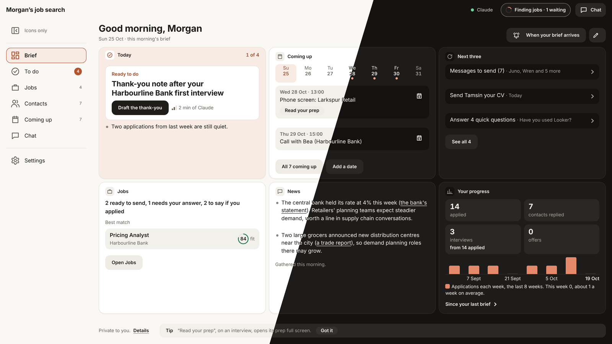
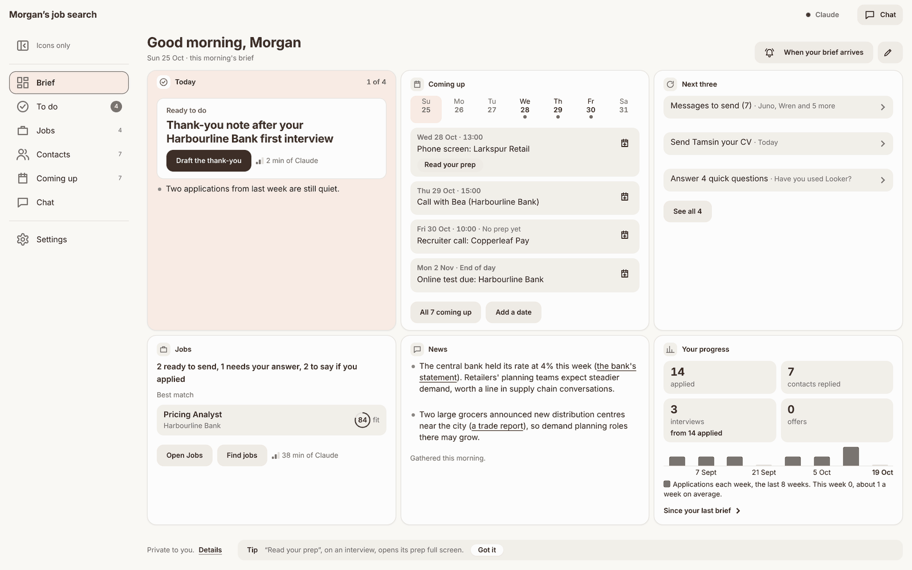
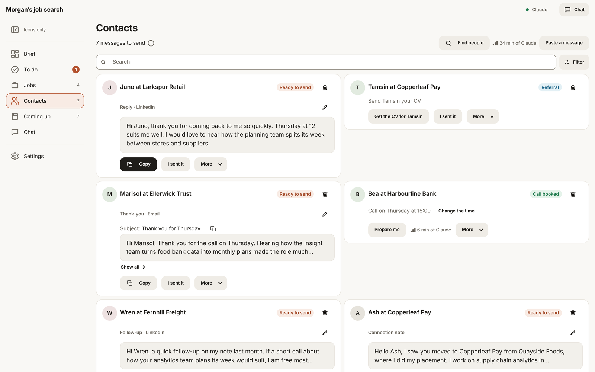
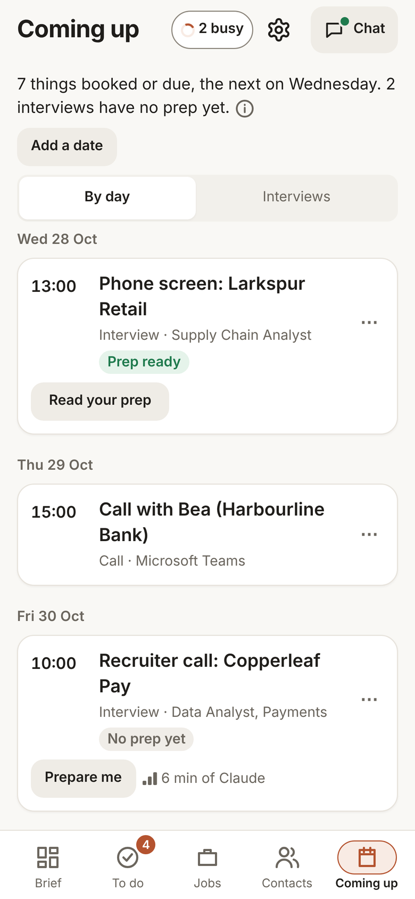

# last-job-search

**The last job search tool you'll ever need.** Claude finds jobs that fit you and scores each
one, writes and checks a resume and cover letter for the ones you pick, finds people worth
talking to, keeps track of everything and gets you ready for interviews. It all happens on one
private page. It never sends anything for you.

  
   
  <b>The Brief</b>: your day at a glance, in light or dark

## What you need

- A GitHub account (free) and a paid Claude plan. Nothing to install: a phone is enough.
  Claude reading LinkedIn profiles for you needs the Claude desktop app on a computer; on a
  phone you paste them instead.
- Using another agent tool? See [AGENTS.md](AGENTS.md).

## Get started

1. On this page, **Use this template**, then **Create a new repository**, **Private**. Never
   **Fork**: a fork is public, and GitHub never lets one be made private.
2. Open [claude.ai/code](https://claude.ai/code), connect GitHub, and install the
   [Claude GitHub App](https://github.com/apps/claude/installations/new) on your copy only.
3. Choose your copy and say **"set me up"**. Where the chat offers **Auto**, choose it, so
   Claude carries on while you're away ([START_HERE.md](START_HERE.md) says where).

No resume yet? Say "build one with me". [START_HERE.md](START_HERE.md) has each step, and
[HELP.md](HELP.md) helps if something goes wrong.

## What it looks like

  
   
  A walk through the page. Every name is made up.

  
  &nbsp;
  
   
  Contacts on a computer, and Coming up on a phone

## What you do

| Tap | You get |
|---|---|
| **Find jobs** | New jobs, each scored 0 to 100 against you, with the reasons |
| **Draft this** | A resume and cover letter for that job, checked |
| **Find people** | People worth talking to, and a first note for each |
| **To do** | Replies and follow-ups that are due, drafted for you |
| **Prepare me** | Likely questions, your best answers and questions to ask |
| The **pencil**, or the **trash** | Your change, or a no and why: it remembers both |

Anything else, ask in **Chat** on the page.

## The chats you'll see

Claude works in chats of its own, so your list of chats shows a few named "Last Job Search"
that you didn't start: the app itself is your page, and these chats run behind it. Nothing is wrong, and you never need to open or type in them unless a card
on your page's **To do** says so: your page is the one place you use. Delete one by mistake
and nothing is lost: the app starts it again when it's needed.

| Chat | What it does | How long it stays |
|---|---|---|
| **Last Job Search · Page** | Answers your page and its **Chat** | Replaced often: each day you use your page, or sooner once it grows long, a fresh one takes over; the old one is called "Last Job Search · Page (finishing up)" for a little while, then is put away by itself. An old one is safe to delete |
| **Last Job Search · Brief** | Writes your brief on its days, in a chat of its own so your page still answers at once | Stays for good. When it grows long, a fresh one takes over and the old one is put away by itself |
| **Last Job Search · Computer link** | Only if you use your computer for LinkedIn: starts the chats there | Stays for good, so you allow it only once (below). One made by an older version takes this name at the next daily tidy-up |
| **Last Job Search · *the work*, *its day*** (for example "Last Job Search · Finding jobs, 16 Nov") | One big job: finding jobs, drafting, finding people, an interview prep, or a question in **Chat** while the page is busy ("Chat questions") | Put away by itself when the work is done |
| **Last Job Search · *the work*** | A job that reads LinkedIn on your computer | Put away by itself when the work is done, except the first one, which stays as the one below |
| **Last Job Search · Your computer** | Only if you use your computer for LinkedIn: takes every later LinkedIn job there by itself, so nothing new needs your OK | Stays open on your computer |

So you'll normally see three that stay (two if you don't use a computer), plus the one on your
computer and one for each job while it runs. Chats an older version made are put away by
themselves too, and each can be brought back; the ones that stay take these names by
themselves.

**The first time Claude uses your computer**, "Last Job Search · Computer link" asks "Let Claude use your computers and other sessions from here?". Choose Allow, once. A
card on your page's **To do** says which chat and what to choose. After that first job, the
chat on your computer takes the next ones by itself, with nothing to allow.

## Why it's different

- **It ranks, it doesn't hide.** A missing skill lowers a score; only real deal-breakers rule
  a job out.
- **It works your network**, not just job boards, and reminds you when to follow up.
- **It checks its own work**: every resume is read back the way hiring software reads it,
  and every claim against what you told it.
- **It learns** from what you change, and **updates itself**.

## Your data and security

Everything about you stays in your private copy. Job postings are treated as data, never as
instructions, and a check fails any change that weakens the permission allowlist.
[SECURITY.md](SECURITY.md) has the details.

## For the technically curious

| | |
|---|---|
| Setting up by hand | [SETUP.md](SETUP.md) |
| What a search does | [RUNBOOK.md](RUNBOOK.md) |
| The rules every chat follows | [CLAUDE.md](CLAUDE.md) |
| How it works and what it costs | [ARCHITECTURE.md](ARCHITECTURE.md) |
| Bugs and ideas | [CONTRIBUTING.md](CONTRIBUTING.md) |
| Working on the app | [MAINTAINING.md](MAINTAINING.md) |

Searching and scoring are plain Python, so thousands of postings cost no model time. The
employer-board reader is also published as [openroles](https://github.com/aranculleton/openroles).

## Credits and licence

Built on [MadsLorentzen/ai-job-search](https://github.com/MadsLorentzen/ai-job-search) (v1.7.0
plus the commits through PR #413). MIT: [LICENSE](LICENSE) carries both copyrights. Not
affiliated with Anthropic.
