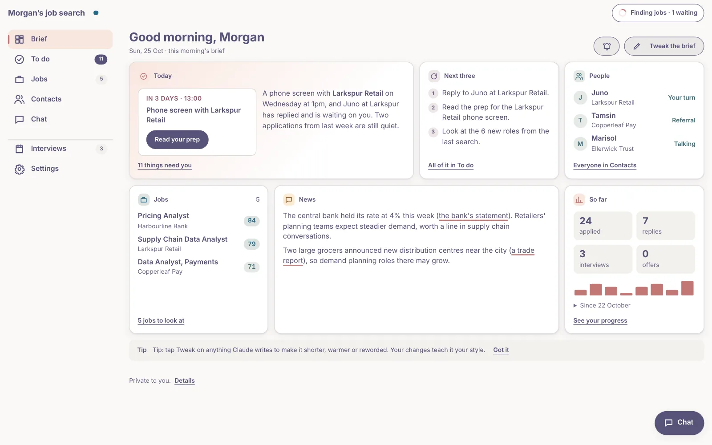
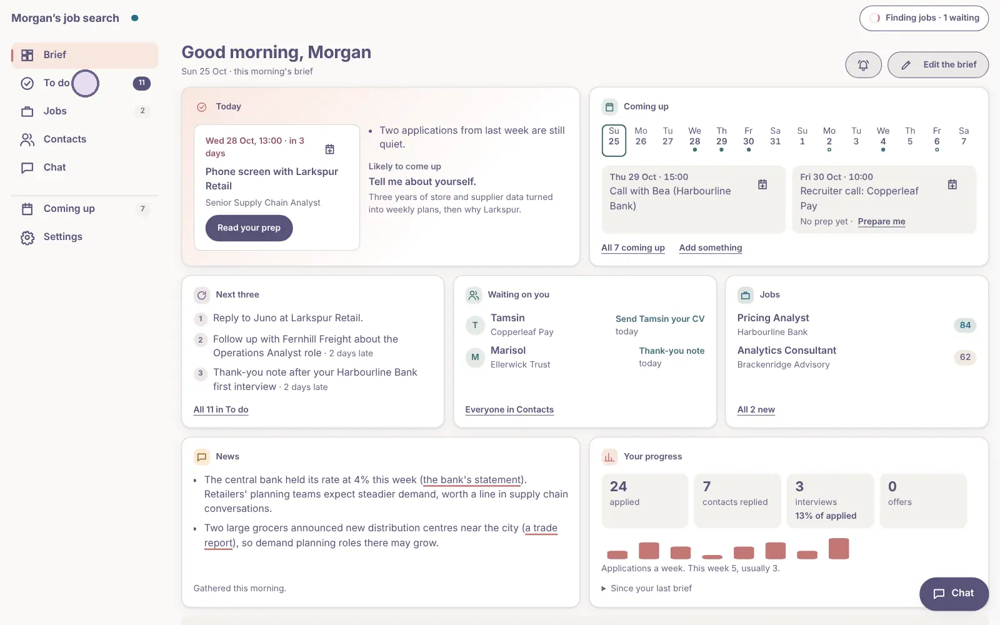
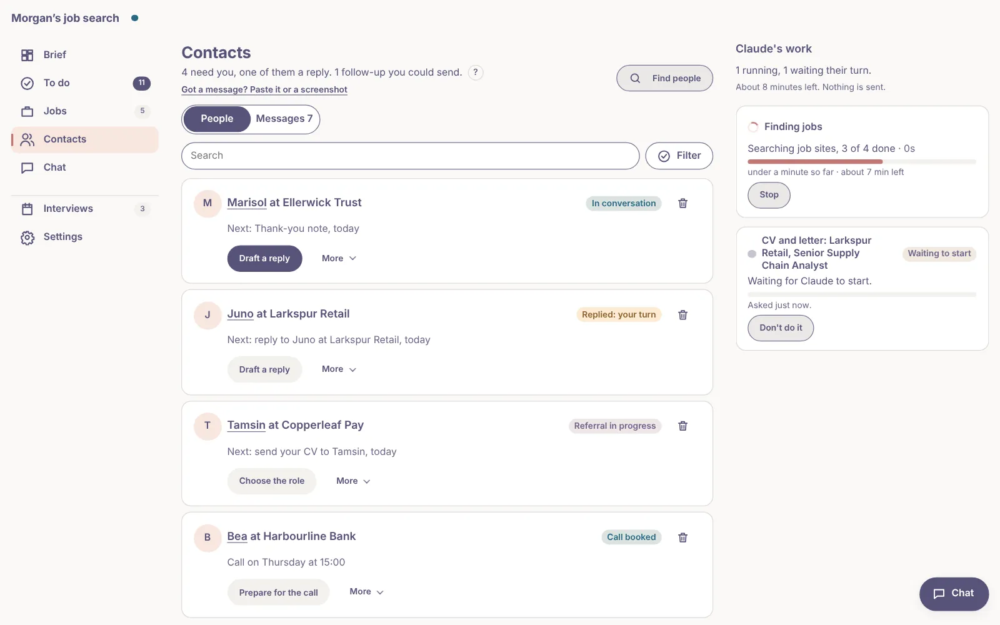
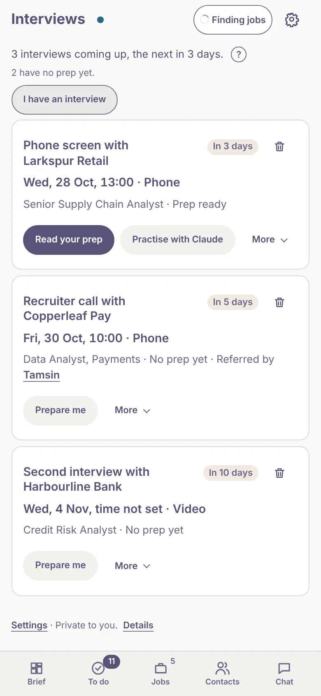

# last-job-search

**The last job search tool you'll ever need.** Claude finds jobs that fit you and scores each
one, writes and checks a resume and cover letter for the ones you pick, finds people worth
talking to, keeps track of everything and gets you ready for interviews. It all happens on one
private page. It never sends anything for you.

  
   
  <b>The Brief</b>: your day at a glance

## What you need

- A GitHub account (free) and a paid Claude plan. Nothing to install: a phone is enough.
- Using another agent tool? See [AGENTS.md](AGENTS.md).

## Get started

1. On this page, **Use this template**, then **Create a new repository**, **Private**.
2. Open [claude.ai/code](https://claude.ai/code), connect GitHub, and install the
   [Claude GitHub App](https://github.com/apps/claude/installations/new) on your copy only.
3. Choose your copy and say **"set me up"**.

No resume yet? Say "build one with me". [START_HERE.md](START_HERE.md) has each step, and
[HELP.md](HELP.md) helps if something goes wrong.

## What it looks like

  
   
  A walk through the page. Every name is made up.

  
  &nbsp;
  

## What you do

| Tap | You get |
|---|---|
| **Find jobs** | New jobs, each scored 0 to 100 against you, with the reasons |
| **Draft this** | A resume and cover letter for that job, checked |
| **Find people** | People worth talking to, and a first note for each |
| **To do** | Replies and follow-ups that are due, drafted for you |
| **Prepare me** | Likely questions, your best answers and questions to ask |
| **Edit**, or the **bin** | Your change, or a no and why: it remembers both |

Anything else, ask in **Chat** on the page.

## Why it's different

- **It ranks, it doesn't hide.** A missing skill lowers a score; only real deal-breakers rule
  a job out.
- **It works your network**, not just job boards, and reminds you when to follow up.
- **It checks its own work**: every resume is read back the way hiring software reads it,
  and every claim against what you told it.
- **It learns** from what you change, and **updates itself**.

## Your data and security

Everything about you stays in your private copy. Job postings are treated as data, never as
instructions, and a check fails any change that weakens the permission allowlist.
[SECURITY.md](SECURITY.md) has the details.

## For the technically curious

| | |
|---|---|
| Setting up by hand | [SETUP.md](SETUP.md) |
| What a search does | [RUNBOOK.md](RUNBOOK.md) |
| The rules every chat follows | [CLAUDE.md](CLAUDE.md) |
| How it works and what it costs | [ARCHITECTURE.md](ARCHITECTURE.md) |
| Bugs and ideas | [CONTRIBUTING.md](CONTRIBUTING.md) |
| Working on the app | [MAINTAINING.md](MAINTAINING.md) |

Searching and scoring are plain Python, so thousands of postings cost no model time. The
employer-board reader is also published as [openroles](https://github.com/aranculleton/openroles).

## Credits and licence

Built on [MadsLorentzen/ai-job-search](https://github.com/MadsLorentzen/ai-job-search) (v1.7.0
plus the commits through PR #413). MIT: [LICENSE](LICENSE) carries both copyrights. Not
affiliated with Anthropic.
